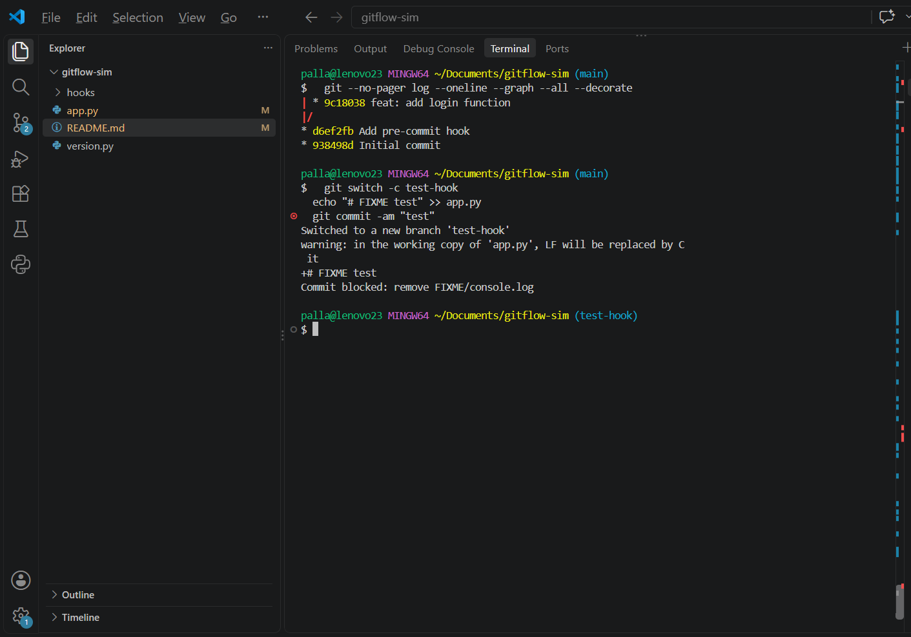
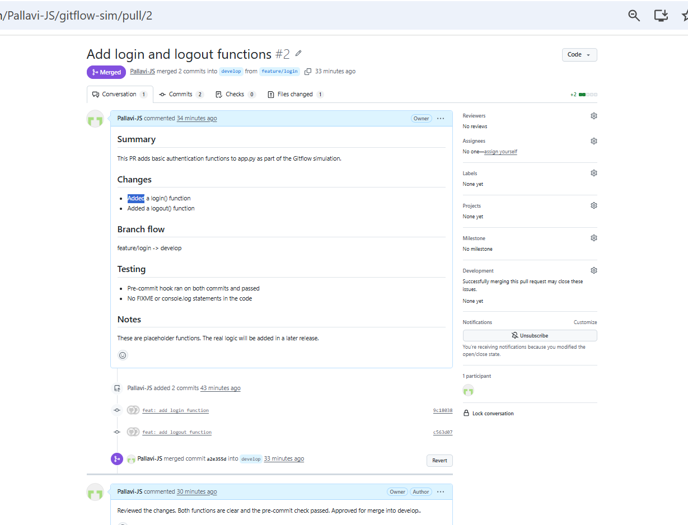
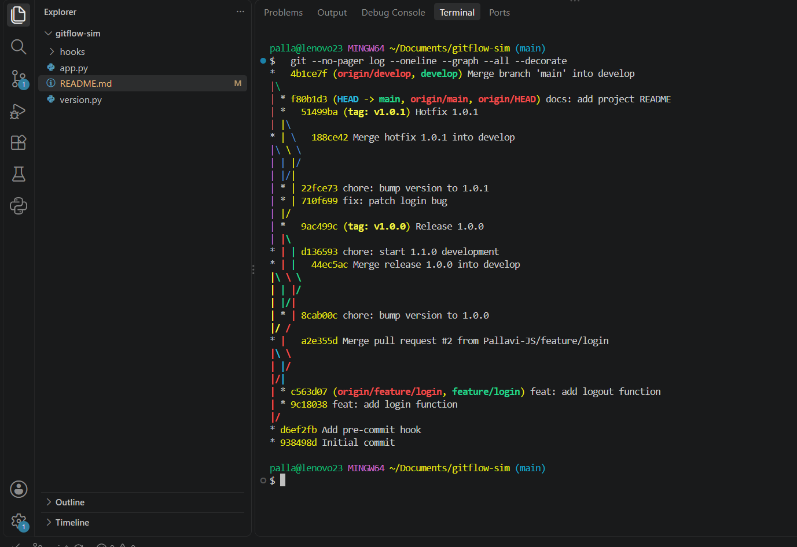
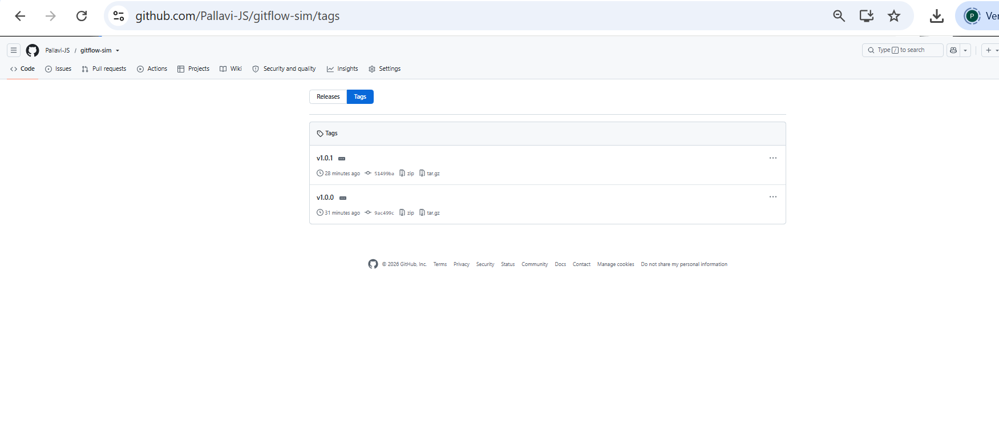

# Gitflow Simulation

**Phase 3: Git Version Control, Mini Project**
Author: Pallavi
Repository: https://github.com/Pallavi-JS/gitflow-sim

This project simulates a complete Gitflow workflow: feature branch, pull request, merge, release, hotfix, merging back to both long-lived branches, and a pre-commit hook that guards every commit.

## Branch strategy

| Branch | Purpose |
|---|---|
| `main` | Production code. Every commit here is a release or hotfix, and is tagged. |
| `develop` | Integration branch for the next release. |
| `feature/*` | New work, branched from `develop` and merged back into `develop`. |
| `release/*` | Release preparation, branched from `develop`, merged into `main` and `develop`. |
| `hotfix/*` | Urgent production fixes, branched from `main`, merged into `main` and `develop`. |

## What was done, step by step

### 1. Repository setup
- Created the repo with `git init -b main`, added `README.md` and `app.py`, and made the initial commit.
- Created the `develop` branch and pushed both branches to GitHub.

### 2. Pre-commit hook
- The hook lives in `hooks/pre-commit` (a tracked folder, because `.git/hooks` is not version-controlled).
- It is enabled with `git config core.hooksPath hooks`.
- It scans the staged changes and rejects the commit if a line being added contains a debug marker (an unfinished-work tag or a debug log call).
- Tested both ways: a commit with a marker was blocked, and a clean commit printed `pre-commit passed`.
- The hook ran automatically on every later commit in this project.

### 3. Feature branch and Pull Request
- Created `feature/login` from `develop` and made two commits: `feat: add login function` and `feat: add logout function`.
- Pushed the branch and opened a Pull Request into `develop` (PR #2) with a description and a review comment, then merged it.
- Note: the first PR (#1) was opened against `main` by mistake. It was closed without merging, and PR #2 was opened against the correct base branch, `develop`.

### 4. Release 1.0.0
- Created `release/1.0.0` from `develop` and added `version.py` with `VERSION = '1.0.0'`.
- Merged the release into `main` with `--no-ff` and tagged it `v1.0.0`.
- Merged the release back into `develop` with `--no-ff`, then deleted the release branch.

### 5. Hotfix 1.0.1
- To simulate real parallel work, `develop` moved on to `VERSION = '1.1.0-dev'`.
- Created `hotfix/1.0.1` from `main`, fixed the bug, and bumped the version to `1.0.1`.
- Merged the hotfix into `main` with `--no-ff` and tagged it `v1.0.1`.
- Merged the hotfix into `develop`. This caused a **merge conflict in `version.py`**, because both branches changed the same line.
- Resolved it manually by keeping `1.1.0-dev` on `develop` (it is already working toward the next release), staged the file, and completed the merge commit.
- Deleted the hotfix branch and pushed `main`, `develop` and all tags.

## Why these choices

**Why `--no-ff`?**
A fast-forward merge moves the branch pointer and leaves no trace that a branch ever existed. `--no-ff` always creates a merge commit, so the history clearly shows where a feature, release or hotfix was integrated. It also makes it easy to revert a whole feature with a single commit.

**Why merge the hotfix into both `main` and `develop`?**
The hotfix must reach production (`main`) immediately. If it were not also merged into `develop`, the fix would be lost the next time a release is cut from `develop`, and the bug would come back. That is why the hotfix is merged into both.

**Why a pre-commit hook?**
It catches mistakes before they enter history, automatically, without relying on anyone to remember a manual check.

## Final history

Run this to see the full branch graph:

```bash
git log --oneline --graph --all --decorate
```

Tags: `v1.0.0` (release) and `v1.0.1` (hotfix).

## Commands used

```bash
git init -b main
git switch -c <branch>
git commit -am "<message>"
git merge --no-ff <branch>
git tag -a <tag> -m "<message>"
git push origin main develop --tags
git config core.hooksPath hooks
```
## Screenshots

### Pre-commit hook blocking a bad commit


### Merged Pull Request


### Final branch graph


### Tags on GitHub

